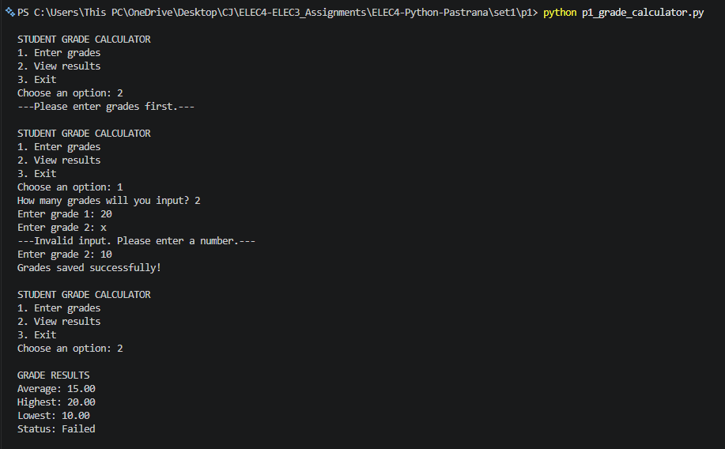
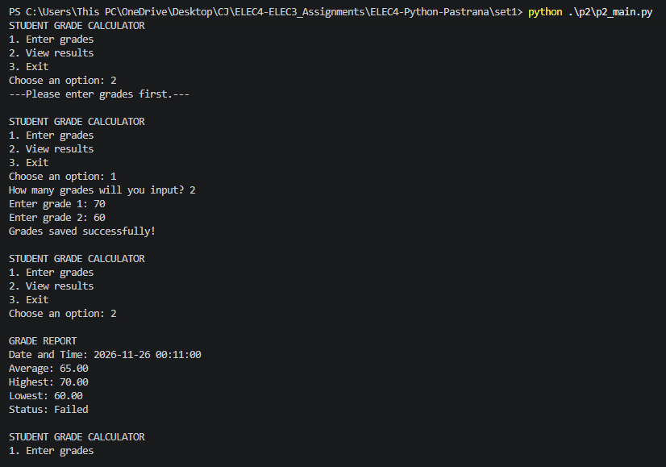
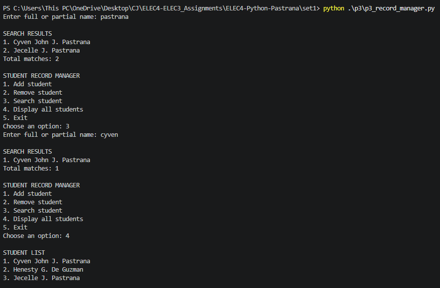
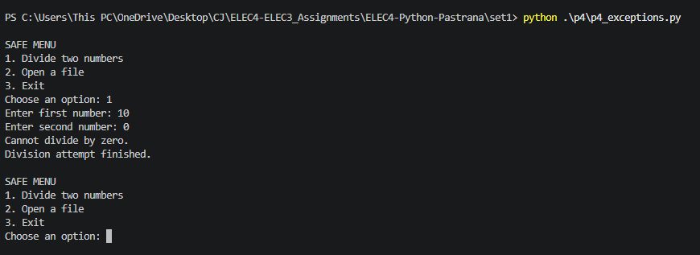

# ELEC 4 - Python Programming

**Name:** Cyven John J. Pastrana  
**Section:** IV-BSIT A  
**Assignment:** Set 1 – Python Activities

## Activities

Run these commands from the `ELEC4-Python-Pastrana` folder.

| Activity | Description | How to run |
|---|---|---|
| [P1 – Student Grade Calculator](set1/p1/) | Calculates the average, highest, and lowest grades and shows whether the student passed. | `python set1/p1/p1_grade_calculator.py` |
| [P2 – Custom Module](set1/p2/) | Uses the functions in `student_utils.py` to generate a grade report with the date and time. | `python set1/p2/p2_main.py` |
| [P3 – Student Record Manager](set1/p3/) | Adds, removes, searches, and displays student names while preventing duplicate entries. | `python set1/p3/p3_record_manager.py` |
| [P4 – Safe Menu Program](set1/p4/) | Handles invalid numbers, division by zero, missing files, and invalid menu choices. | `python set1/p4/p4_exceptions.py` |

## Sample Outputs

### P1 – Grade Results

### P2 – Grade Report

### P3 – Search and Display

### P4 – Division by Zero

